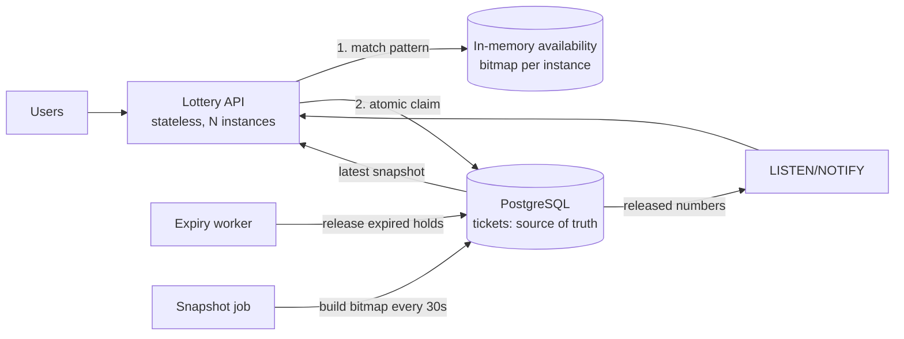

# Lottery Search System: Design

## 1. Problem summary

- 10 million tickets. Each ticket has a 6-digit number (`000000`–`999999`).
- Users search with a 6-character pattern of digits and `*`, for example `****23`, `1****5`, `123***`.
- Two users searching at the same time must never be shown the same ticket.
- Search and allocation must stay fast at 10M+ tickets and under bursty traffic (e.g., right before a draw).

## 2. Key observation

There are 10M tickets but only **1,000,000 possible numbers**, so each number appears on about 10 tickets on average.

That changes the problem. Instead of running a text search over 10M rows, we can:

1. **Generate** the numbers that match a pattern directly. A pattern with `w` wildcards matches exactly `10^w` numbers (`****23` → 10,000 numbers; `123***` → 1,000).
2. **Check availability** of each candidate number in a tiny in-memory structure.
3. **Claim** concrete tickets for those numbers atomically in the database.

Search (fast, may be slightly stale) and allocation (authoritative, atomic) are separate steps. Correctness never depends on the search index being up to date; it only depends on the database claim.

## 3. Architecture



- **PostgreSQL** is the single source of truth for tickets and their status.
- Each **API instance** keeps an availability bitmap in memory and uses it only as a hint to find candidate numbers.
- A single **snapshot job** builds the bitmap and stores it for all instances to load.
- An **expiry worker** returns tickets whose hold has expired to the pool.

## 4. Data model (PostgreSQL)

```sql
tickets (
  id             BIGSERIAL PRIMARY KEY,
  draw_id        INT         NOT NULL,
  number         INT         NOT NULL CHECK (number BETWEEN 0 AND 999999),  -- formatted with leading zeros on output
  status         TEXT        NOT NULL CHECK (status IN ('AVAILABLE', 'RESERVED', 'SOLD')),
  reserved_by    BIGINT,
  reserved_until TIMESTAMPTZ,
  CHECK (status <> 'RESERVED' OR (reserved_by IS NOT NULL AND reserved_until IS NOT NULL))
)

-- Only available tickets are searched, so a partial index stays small and hot
CREATE INDEX idx_available ON tickets (draw_id, number) WHERE status = 'AVAILABLE';

-- Lets the expiry worker find expired holds without a full scan
CREATE INDEX idx_expiring ON tickets (reserved_until) WHERE status = 'RESERVED';

idempotency_keys (
  user_id     BIGINT      NOT NULL,
  key         TEXT        NOT NULL,
  ticket_ids  BIGINT[]    NOT NULL,
  created_at  TIMESTAMPTZ NOT NULL DEFAULT now(),
  PRIMARY KEY (user_id, key)
)
```

Storing `number` as an integer keeps the index compact. Size estimate: 10M rows at roughly 60–80 bytes each plus indexes is about 1–1.5 GB, which fits comfortably in memory on a modest database instance.

## 5. Search algorithm

### 5.1 Availability bitmap (a hint, not the truth)

For each draw, each API instance holds a bitset of 1,000,000 bits (**125 KB**), where bit `n` means "number `n` probably has an available ticket".

The bitmap is deliberately allowed to be wrong for a short time. A wrong "available" bit costs one failed claim; a wrong "sold out" bit hides a number until the next refresh. Neither can cause a duplicate, because PostgreSQL decides every claim.

How it stays close to the truth:

- **One builder, many readers:** a single snapshot job (not every API instance) rebuilds the bitmap every 30 seconds and stores it with a version number in a small table, `bitmap_snapshots(draw_id, version, bits BYTEA, built_at)`. API instances load the latest 125 KB snapshot at startup, **on every reconnect** to the database, and whenever the version changes. The database scans the available tickets once per interval, no matter how many API instances run.
- **Building the snapshot:** a plain `SELECT DISTINCT number ... WHERE status = 'AVAILABLE'` reads every entry in `idx_available` (close to 10M early in a draw), because PostgreSQL has no loose index scan for `DISTINCT`. The job instead emulates a loose index scan with a recursive CTE that jumps to the next distinct number each step (`WHERE number > previous ORDER BY number LIMIT 1`), so it does at most 1M index probes. Running it in one job keeps even this cost off the API instances.
- **Clear locally after a short chunk:** when a claim chunk returns fewer tickets than it asked for (see 6.2), every available ticket for that chunk's numbers has just been claimed, so the instance clears the bits of the chunk's numbers that returned nothing. It does **not** clear bits when a chunk is filled, because `LIMIT` may have stopped before reaching the other numbers.
- **Set on release:** when tickets go back to `AVAILABLE` (expiry or cancellation), the releasing transaction sends `NOTIFY` with the released numbers, batched to stay under PostgreSQL's 8,000-byte payload limit. Every instance sets those bits.

`LISTEN/NOTIFY` does not guarantee delivery: notifications sent while a connection is down are lost. Loading the latest snapshot on reconnect, plus the 30-second snapshot cycle, covers that gap.

One more known imprecision: a row skipped by `SKIP LOCKED` may belong to a transaction that later rolls back, so a bit can be cleared while the number is still available. This is acceptable for a hint; the next snapshot restores it.

**Why not an exact counter?** An alternative is a `number_stock(draw_id, number, available_count)` table updated in the same transaction as each claim. It makes "sold out" exact, but every claim on a popular number would then update the same counter row, which reintroduces the lock contention that `SKIP LOCKED` removes on the ticket rows. Treating the bitmap as a self-correcting hint keeps claims contention-free.

### 5.2 Matching a pattern

1. Validate the pattern: exactly 6 characters, each `0-9` or `*`.
2. Record the wildcard positions `w`. The match space has `M = 10^w` numbers, indexed `0..M-1` (the index fills the wildcard digits; fixed digits come from the pattern).
3. Pick a random `start` in `[0, M)` and a random `step` that shares no factor with 10 (any odd number not divisible by 5). Visit indices in the order `(start + i × step) mod M` for `i = 0, 1, 2, ...`.
4. For each candidate number, check its bit. Collect available numbers in visiting order.

Because `M` is a power of 10, its only prime factors are 2 and 5, so any `step` coprime with 10 visits **every** index exactly once before repeating. Each user gets a full permutation of the match space that looks random, and two users who happen to start close together do not walk over the same numbers in the same order.

### 5.3 Cost per pattern

| Pattern | Wildcards | Matching numbers | Work |
| :--- | :---: | :---: | :--- |
| `123456` | 0 | 1 | 1 bit check |
| `123***` | 3 | 1,000 | at most 1,000 bit checks |
| `1****5` | 4 | 10,000 | at most 10,000 bit checks |
| `****23` | 4 | 10,000 | at most 10,000 bit checks |
| `******` | 6 | 1,000,000 | stops after a page's worth of hits while availability is high |

Work is bounded by `min(10^w, hits needed / availability ratio)`. Even the worst case, scanning all 1M bits when almost everything is sold, is about a millisecond of CPU and touches no database.

### 5.4 Why not a generic text search

- `LIKE '%23'` cannot use a B-tree index, so every suffix or middle pattern becomes a full scan.
- Trigram indexes (`pg_trgm`) or Elasticsearch wildcard queries are built for large, open vocabularies. Here the vocabulary is only 1M fixed-length numbers, so enumerating matches directly is simpler and faster.
- A search engine also cannot allocate tickets transactionally, so we would still need the database for the claim step.

## 6. Allocation: no duplicate results

### 6.1 Reserve on search

Tickets returned to a user are **reserved for that user** at the moment they are returned. A user never sees a ticket that someone else is holding. The hold has a short TTL (for example, 5 minutes) to complete payment.

### 6.2 Atomic claim

The API claims in **small chunks that follow the user's own visiting order** (for example, the next 2 × page size candidate numbers). Sending one huge candidate list would let PostgreSQL return rows in index order (lowest numbers first), so users with overlapping patterns would all compete for the same low numbers. Chunking keeps the random spread from 5.2.

Each chunk is claimed with one statement:

```sql
WITH picked AS MATERIALIZED (
  SELECT id FROM tickets
  WHERE  draw_id = $draw AND number = ANY($chunk) AND status = 'AVAILABLE'
  LIMIT  $needed
  FOR UPDATE SKIP LOCKED
)
UPDATE tickets t
SET    status = 'RESERVED', reserved_by = $user, reserved_until = now() + interval '5 minutes'
FROM   picked
WHERE  t.id = picked.id
RETURNING t.id, t.number;
```

- The CTE locks the chosen rows once. A row-locking CTE is never inlined, so the `LIMIT` is applied exactly once; a `WHERE id IN (SELECT ... LIMIT ... FOR UPDATE)` subquery can be executed more than once by the planner and lock or update more rows than intended.
- `SKIP LOCKED` makes concurrent requests skip rows another request is already claiming, instead of waiting. Two users searching `****23` at the same instant always end up with **different** tickets, and neither blocks the other.
- If a chunk returns fewer rows than needed, the API clears the bits of numbers that returned nothing and claims the next chunk, until the page is full or the match space is exhausted.

### 6.3 Releasing holds

- **Expiry:** a worker runs every few seconds: `UPDATE ... SET status = 'AVAILABLE' WHERE status = 'RESERVED' AND reserved_until < now()`, using `idx_expiring`, then sends `NOTIFY` for the freed numbers. An expired hold can therefore stay unclaimable for up to one worker interval. We accept that small delay rather than adding `OR (status = 'RESERVED' AND reserved_until < now())` to the claim query, which would complicate its index.
- **Purchase:** `UPDATE ... SET status = 'SOLD' WHERE id = $id AND status = 'RESERVED' AND reserved_by = $user AND reserved_until > now()`.
- **Purchase vs. expiry race:** both are conditional `UPDATE`s on the same row. The row lock orders them, and PostgreSQL re-checks the `WHERE` condition after acquiring the lock, so exactly one of them succeeds. A late payment fails cleanly instead of selling an expired hold.
- **Explicit release:** when the user searches again or leaves, their previous holds are released the same way.

### 6.4 Retries

The reserve request carries an `Idempotency-Key`. The key and the reserved ticket IDs are stored in `idempotency_keys` in the same transaction as the claim, with a TTL of 24 hours (cleaned up by the same worker). If the client retries after a timeout, the API does not reserve again. It returns only the stored tickets that are **still** `RESERVED` by this user with `reserved_until > now()`. Tickets whose hold has already expired may now belong to someone else, so they are never returned; if that leaves the page short, the API claims new tickets to fill it and updates the stored record.

## 7. Performance and capacity

- **Search:** in-memory, microseconds to about a millisecond per request, with no database round trip.
- **Claim:** one indexed `UPDATE` touching only a page of rows on a small partial index, typically single-digit milliseconds.
- **Throughput estimate:** a single well-sized PostgreSQL primary can handle on the order of a few thousand small indexed `UPDATE` transactions per second. At one claim per search, that is a few thousand searches per second before the database becomes the limit. This is a rough estimate to confirm with a load test, not a guarantee.
- **Contention:** per-user random permutations spread users across the match space, and `SKIP LOCKED` removes lock waits, so throughput scales with concurrent requests instead of serializing on hot numbers.
- **Growth beyond 10M:** the bitmap stays at 125 KB even at 100M tickets, because the number of possible 6-digit numbers is still 1M. Only the `tickets` table and its indexes grow.
- **Scaling out:** API instances are stateless apart from the rebuildable bitmap, so we add instances behind a load balancer. Search reads never reach the database.
- **Verification:** load test the reserve endpoint (e.g., JMeter or k6) with many users firing the same pattern, and assert that no ticket ID is returned twice.

## 8. Database choice

**PostgreSQL** as the system of record:

- Row-level locking with `FOR UPDATE SKIP LOCKED` gives atomic, non-blocking allocation, which is exactly the hard requirement.
- Partial indexes keep the working set small (only available tickets).
- ACID transactions make purchase and expiry safe without extra coordination.
- Mature and simple to operate: one database, standard backups and replicas.

**Scale-up option: Redis for the hot path.** If load tests show PostgreSQL is the bottleneck, keep a Redis set of available ticket IDs per number and claim with `SPOP`, which is atomic and very fast. Holds go into a sorted set scored by expiry time. PostgreSQL remains the source of truth, and a reconciliation job keeps Redis in sync.

- **Benefit:** higher claim throughput and lower latency.
- **Cost:** a second system to run, plus the risk of Redis and the database drifting apart.

## 9. Tradeoffs and assumptions

- **Reserve-on-search holds inventory:** users who search and leave keep tickets out of the pool for the TTL. Mitigations are a short TTL, a cap on holds per user, and releasing old holds on each new search.
- **The bitmap is a hint:** it can briefly hide a number that was just released, or point to one that just sold out. Both self-correct within one refresh, and neither affects correctness.
- **Index churn:** every status change moves a row into or out of `idx_available` and `idx_expiring`. Because `status` is in the predicate of both indexes, none of these updates can be HOT updates, so the table and indexes bloat faster during peaks. Mitigations: more aggressive autovacuum on `tickets` (lower `autovacuum_vacuum_scale_factor`) and monitoring bloat around draw days.
- **Snapshot cost:** the snapshot job does up to 1M index probes every 30 seconds. If that becomes noticeable at peak, the interval can be lengthened, since releases already reach instances through `NOTIFY`.
- **Expiry delay:** expired holds return to the pool within one worker interval (a few seconds).
- **Assumed:** each search returns a small page (for example, 10–20 tickets); tickets belong to one draw at a time; payment completes within the hold TTL.